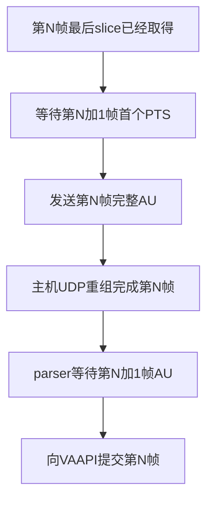

# 帧边界等待：sender和viewer分别在等下一帧

结论：当前链路有两道应用层的帧结束确认。sender把同一PTS的slice拼成完整
H.264 access unit（AU），收到下一PTS才发送；viewer拿到完整AU后仍按连续字节流解析，
默认Annex-B parser也要看到下一AU才输出上一帧。这是数据边界确认造成的缓冲，
不是配置了10ms sleep，也不是VAAPI需要10ms才能计算一帧。

本轮探索保持正式sender/viewer、协议、SDK、镜像和sensor配置不变。新增独立native解码探针，
以及ignored目录中的mode1诊断版sender。没有自动重启或烧写。

## 两道等待的具体位置

`src/aura-sender/src/mpp_sender.cpp`的run_stream逻辑：

1. `GetStream`取得一个pack，将payload追加到access_unit。
2. 只要`pack.u64PTS == access_unit_pts_us`，继续收集同一幅图的slice。
3. `pack.u64PTS != access_unit_pts_us`时才调用send_access_unit发送旧PTS。
4. 退出时没有后继PTS来证明完整的pending AU直接丢弃，避免发送半帧。

因此有限120帧测试实际还需要取到第121帧的首包，才能发送第120帧。
mode3下，第一slice到最后slice是编码输出跨度；最后slice到下一PTS则是额外确认等待。

`src/host-viewer/src/main.cpp`在FrameReassembler交回payload后调用
`H264AnnexBParser::submit_chunk`。它没有设置`PARSER_FLAG_COMPLETE_FRAMES`，
也没有直接调用decoder.submit_access_unit。虽然当前sender已经做过AU聚合，
parser只知道收到了一段字节，不知道调用边界就是完整图像边界，因而保留上一AU。

FFmpeg的[h264_parse源码](https://ffmpeg.org/doxygen/trunk/h264__parser_8c_source.html)
在COMPLETE_FRAMES模式下使用本次buf_size作为结束；普通模式调用h264_find_frame_end，
找不到结束时ff_combine_frame返回没有输出。下一张图的slice头或相关分隔NAL出现后，
才确认上一幅图结束。这个行为也已用本机实际FFmpeg n9.0.2验证。

连续运行时逻辑如下；这不是跨设备时钟测量：



## 干净软件基线：约18ms是确认等待，不是20ms都能删

取上一轮默认IRQ/watchdog、未启用pack debug的双路基线，单位ms：

| 阶段 | camera0 mean | camera1 mean | 含义 |
| --- | ---: | ---: | --- |
| sender.au_pack_span | 2.240 | 2.204 | 已取得的第一pack到最后pack，不能简单当作无用等待 |
| sender.next_pts_wait | 7.832 | 7.868 | 最后pack到下一PTS确认并准备发送，包含少量应用处理 |
| sender.first_pack_to_send | 10.072 | 10.072 | 上述两项之和，不能全部算额外缓冲 |
| host.parser_wait | 9.995 | 10.028 | 完整重组AU ready到decoder提交，大部分在等下一AU |
| host.submit_to_frame | 0.097 | 0.124 | 提交到取得VAAPI AVFrame对象，不代表GPU工作或显示扫描完成 |

当前约99.23fps，帧周期约10.08ms，和两道等待吻合。可以优先争取移除约
7.8+10=17.8ms的软件缓冲；这只是当前阶段测量支持的优化空间，不是已实现的端到端收益。
UDP排队与重组时间会有重叠，不能把全部阶段均值直接相加成单向网络或screen-to-screen延迟。
提高HZ、调IRQ或加LOW_DELAY解码flag不会自动取消这些应用层的数据依赖。

## 为什么sender不能直接信任bFrameEnd

本轮使用正式sender，双路各120帧、720p、slice_ctus120、wrap0，打开AURA_DEBUG_PACKS。
记录1922个pack，全部bFrameEnd=1：240组完整PTS各8个pack，另2组是末尾用于确认的首包。
换言之当前mode3在每个slice上都报告end=1，而不是仅最后一个slice报告。
每组8包是本次实际观测，不能硬编码为所有分辨率/参数下的帧尾规则。

内核`sysdrv/drv_ko/kmpp/kmpp/vcodec/mpp/codec/mpp_enc_impl.c`的
`mpp_enc_impl_slice_info`确实区分slice_info.last，并仅在最后slice设置
`KMPP_PACKET_FLAG_EOI`。但公开MPI pack结构没有单独EOI字段；当前板端bFrameEnd
没有反映这个区别。Rockit用户库是预编译文件，本轮没有证明EOI在哪一层丢失，
也没有更改其ABI或绕过MPI去取私有对象。

靠固定slice数量、固定等待1ms/3ms，或把所有end=1当成整帧，都会在时序变化时冒险发送残帧。
这和此前绿色条块问题属于同一类边界错误，不能为了低延迟重新引入。

## 主机独立探针：可以移除第二道等待

新增`tools/test-frame-boundary-wait`及`tests/latency/frame_boundary_probe.cpp`。
native编译探针，链接生产H264VaapiDecoder和H264AnnexBParser；不改变viewer默认行为。
用ffprobe离线列出的AU位置/长度，每10ms输入一帧，比较三种方法：

- stream：生产连续字节流parser；第一AU不出帧，输入120个AU后仅有119帧，flush补齐最后一帧。
- complete-parser：实验parser设置COMPLETE_FRAMES；每次给一个已知完整AU，第一AU立即出帧。
- direct：一个已知完整AU直接交生产decoder；第一AU也立即出帧。

生成的12帧4-slice x264样本、旧双路录像、新mode3双路录像、mode1双路录像均通过。
所有输入无B帧重排序，三种方法最终帧数与VAAPI硬件帧数相同，无解码警告。
在新mode3实拍120帧中：

| 路径 | camera0 parser_wait mean / AU-ready→frame mean | camera1同指标 |
| --- | --- | --- |
| 普通parser | 9.931 / 10.048ms | 9.935 / 10.096ms |
| 完整AU parser | 0.018 / 0.176ms | 0.016 / 0.180ms |
| 直接decoder | 0.010 / 0.218ms | 0.006 / 0.190ms |

direct路径里的parser_wait名称沿用生产decoder计时点，实际只是ready到提交的复制/分配时间。
实验包含冷启动与末帧flush，不是严格稳态性能对照；最明确的证据是第一AU即可出帧，
无需下一AU，而不是两种立即提交路径谁快几微秒。输出VAAPI对象也不代表GPU已完成所有工作。

复现（native CachyOS；无需开发板）：

```sh
./tools/test-frame-boundary-wait \
  --input captures/ar0234-stereo/camera0.h264 \
  --input captures/ar0234-stereo/camera1.h264 \
  --output logs/frame-boundary/my-probe
```

不提供--input时也会生成multi-slice样本。output要求新目录；需要本机c++、pkg-config、
ffmpeg和已安装的VAAPI相关库。本轮没有新增安装依赖。该探针依靠离线AU边界，
没有把任意slice或乱序UDP分片标成完整帧，也没有测屏幕显示。

## SDK mode1实机可行，但还没有优化正式程序

SDK `media/rockit/out/include/rk_comm_venc.h`明确区分：

- mode1：按MB/CTU分slice，所有slice集中在一个packet返回；
- mode3：一个slice一个packet返回，最多8个slice。

临时复制mpp_sender.cpp，仅将`slice_split.u32SplitMode = 3U`改为1U，使用原common与sender
CMake设置，在Ubuntu22.04 aura-sdk Distrobox交叉编译成功，部署到单独的
`/userdata/teleop-boundary-mode1`。正式`/userdata/teleop-sender`哈希不变。
诊断版仍保留原PTS聚合、资源回收、帧数控制和UDP协议。

mode1双路各120帧通过，记录242个pack、242组PTS，每PTS仅一个pack，全部end=1。
240个AU全部完整接收并VAAPI硬解；WaitFreeMB、SYS_Exit成功，SSH一直在线。
mode1录像也通过上述三种native输入实验。

因为PTS等待代码没有改，诊断版依然等下一整帧到达，next_pts_wait约10.2ms。
所以“单独切换mode1”并不会带来所需收益。这次验证的是整帧返回契约可用，
为下一轮去掉确认等待提供基础；debug日志会干扰耗时，不用于宣称优化收益。
临时源文件及CMake在`build/frame-boundary-mode1-source/`，完整构建日志和源哈希在
`logs/frame-boundary/20261013-live/`及结构化记录中；这些生成文件不入Git。

## 建议的下一轮实现顺序

1. 先改主机完整AU输入路径，保留字节流parser给旧slice发送端和文件输入。
   推荐协议flags新增“完整AU”标记，由真正聚合整帧的sender设置；接收端在同一帧内核对
   分片标记一致，收齐全部分片后才允许立即提交。没有标记时沿用兼容parser，
   不把旧sender的slice包误当整帧。给双路、乱序、丢片、IDR/SPS/PPS、末帧flush补齐测试。
2. 给sender添加明确的整帧输出模式：mode1拿到完整pack即发送，不再等下一PTS。
   模式要进入配置与日志；mode3继续保持原保守聚合，不能将bFrameEnd改为通用结束判断。
   先按每路120帧、相同分辨率/码率/GOP/采集时序做A/B，检查损坏码流、丢帧和生命周期回归。
3. 后续如要保留逐slice网络流水，再追查真实EOI从KMPP到MPI的传递，设计帧尾协议。
   不立即重写MPP路径，也不恢复已有双路串扰问题的wrap模式。

以上两步属于应用改动，当前不需要烧录新镜像。本轮已经结束全部sender及USB日志测试，
板端保持默认诊断设置、正式程序和镜像不变。原始码流/日志/binary均ignore。

[阶段数据、两种SDK模式及探针对照](baselines/2026-10-13-frame-boundary-exploration.json)。

